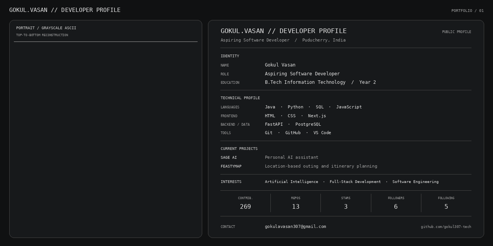

<div align="center">

<picture>
  <source media="(prefers-reduced-motion: reduce)" srcset="profile-dashboard.svg">
  <a href="profile-dashboard.svg"></a>
</picture>

# Gokulavasan
### `Aspiring Software Developer` · Puducherry, India

[](https://github.com/gokul307-tech)
[](mailto:gokulavasan307@gmail.com)

</div>

```text
┌─[ gokul@github ]─────────────────────────────────────────────┐
│  OS       : B.Tech Information Technology — 2nd Year         │
│  NOW      : Building SAGE AI & FeastyMap                     │
│  PREV     : Student | Learning Software Development          │
│  FOCUS    : AI · Full-Stack Development                      │
│  LOCATION : Puducherry, India                                │ 
└──────────────────────────────────────────────────────────────┘
```

<div align="center">

</div>

# 💫 About Me:
- 🔭 **I'm currently working on:** SAGE AI – a personal AI assistant, and FeastyMap – a location-based outing planner.<br>- 🤝 **I'm looking to collaborate on:** Open-source projects, AI-powered applications, and full-stack web development.<br>- 🌱 **I'm currently learning:** Next.js, advanced Python, backend development, and AI integration.<br>- 💬 **Ask me about:** Python, Java, SQL, FastAPI, web development, and my projects.<br>- ⚡ **Fun fact:** I'm a 2nd-year IT student who loves turning ideas into real-world software projects!


## 🌐 Socials:
[](https://instagram.com/https://www.instagram.com/mindless_start?dmpr=MTJybWw5eDdicGhxMw==) [](https://linkedin.com/in/https://www.linkedin.com/in/gokulavasan-murugananthan/) [](https://pinterest.com/https://in.pinterest.com/gokulavasan307/) [](https://x.com/https://x.com/Gokulawasan) [](https://youtube.com/@https://www.youtube.com/@Gokulavasan-w1i) [](mailto:gokulavasan307@gmail.com) 

# 💻 Tech Stack:
                  


### ✍️ My Dev Quote
**"Mes points forts ? Je ne cesse de m’adapter aux choses qui me font me sentir plus mal !"**


## Checkout My Portfolio

[Click Here !](https://gokulavasan-portfolio.vercel.app/)
