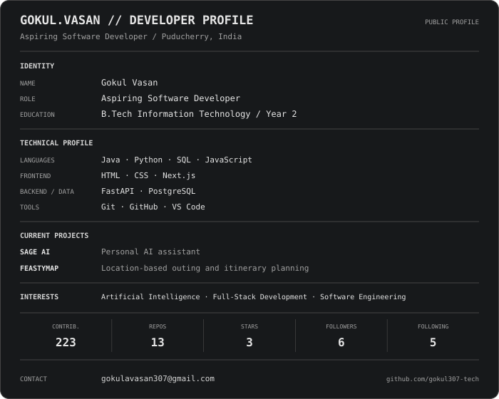
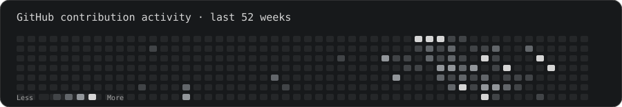

<div align="center">


# Gokul Vasan
### `Aspiring Software Developer` · Puducherry, India

[](https://github.com/gokul307-tech)
[](mailto:gokulavasan307@gmail.com)

</div>

```text
┌─[ gokul@github ]─────────────────────────────────────────────┐
│  OS       : B.Tech Information Technology — 2nd Year       │
│  NOW      : Building SAGE AI & FeastyMap                    │
│  PREV     : Student | Learning Software Development         │
│  FOCUS    : AI · Full-Stack Development                     │
│  LOCATION : Puducherry, India                               │
└──────────────────────────────────────────────────────────────┘
```

<div align="center">

</div>

## `$ whoami`
I'm a second-year Information Technology student and aspiring software developer, exploring how useful products are designed and built. I'm currently working on AI-powered experiences and practical full-stack applications.

## `$ ls ./projects`
| Project | What I'm building |
|---|---|
| **SAGE AI** | A personal AI assistant focused on useful everyday workflows. |
| **FeastyMap** | An outing-planning experience focused initially on Pondicherry. |

## `$ cat skills.txt`
`Python` · `Java` · `SQL` · `FastAPI` · `HTML` · `CSS` · `JavaScript` · `Git` · `GitHub` · `Next.js`

## `$ git log --oneline`
- Building **SAGE AI**
- Building **FeastyMap**
- Exploring **AI** and **Full-Stack Development**

## `$ ./contributions`
<div align="center">

<br/><sub>Contribution activity refreshes automatically through GitHub Actions.</sub>
</div>

---
<div align="center"><sub>Built with curiosity, code, and a terminal window.</sub></div>
